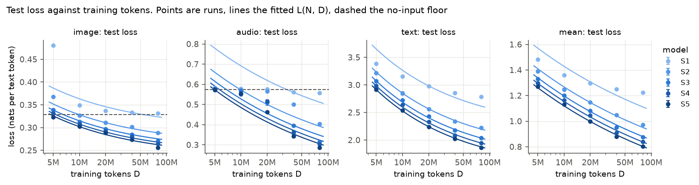
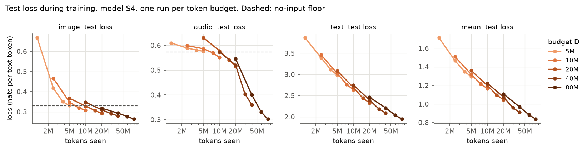
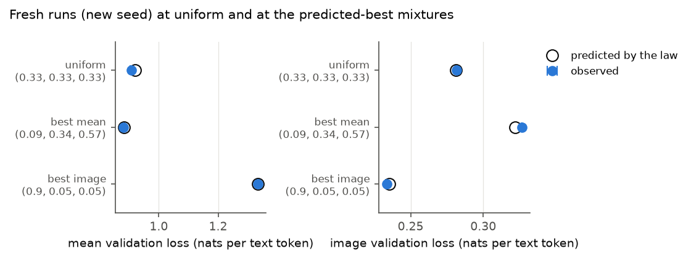
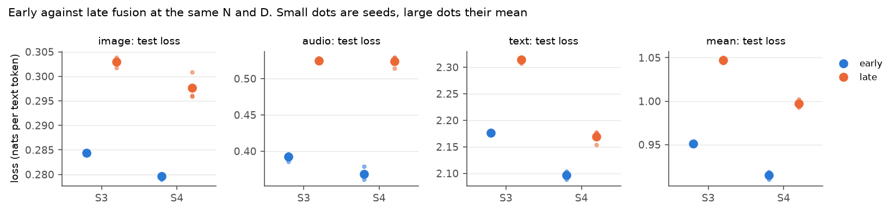

# tiny-native-multimodal-scaling

This is a toy-scale study inspired by two Apple papers. It does not replicate or compare against their results.

One small decoder-only transformer is trained from scratch on three kinds of data at once: CIFAR-100 images to captions, Speech Commands audio to the spoken word, and TinyStories text. There is no image or audio encoder. Image and spectrogram patches go through one linear layer straight into the shared transformer. I measure how the loss scales with model size N and training tokens D (experiment A), how it depends on the data mixture (experiment B), and how early fusion compares to late fusion at the same size (experiment C). A two-page write-up is in [REPORT.md](REPORT.md).



Text loss falls smoothly with N and D, while image and audio stay on their no-input floor until the model is large enough and has seen enough data.



For one model size, audio loss stays flat at the floor and then drops once the model starts to read the spectrogram.



Fresh runs at the mixtures picked by the mixture law land close to the predicted validation loss.

## What I found

All numbers are test loss in nats per text token, from one seed per grid cell, unless stated otherwise. The seed standard deviation of the mean loss, measured on three cells with three seeds each, is 0.003 to 0.009, so differences smaller than that are noise.

**Experiment A: scaling in N and D**

- Text behaves like a textbook scaling law. Test loss falls from 3.38 (S1, 5M tokens) to 1.86 (S5, 80M tokens), and the fitted L(N, D) is off by 1.2% on average over the text runs.
- Image and audio work in two regimes. The model first learns the caption templates and the label frequencies, which puts the loss on a no-input floor (image 0.329, audio 0.573). Only later does it read the patches. I count a domain as reading its input when its loss is below the floor by more than twice its largest seed standard deviation (0.004 for image, 0.028 for audio). By that rule image reads its input in 16 of 25 grid cells and audio in 11 of 25. Audio needs 20M tokens for S3 to S5 and 40M for S2. S1 never reads either input, at any budget.
- The regime change hurts the fit. The mean error of L(N, D) over the grid is 1.9% for image, 8.6% for audio, 1.2% for text and 1.7% for the mean loss.
- **What did not work: extrapolation.** On held-out runs the joint law loses to a simple per-row power law in most cases. It wins 1 of 8 holdout comparisons (text, largest N, by a hair). For the mean loss it is off by 1.7% against 0.9% for the baseline when predicting the largest model, and by 3.4% against 1.4% when predicting the largest budget. For audio at the largest budget both are poor: 31.2% for the law, 26.6% for the baseline.
- The exponents are not well pinned down. Bootstrap 95% intervals for the mean loss: alpha 0.16 [0.12, 0.43] and beta 0.22 [0.18, 0.35]. For text: alpha 0.24 [0.08, 0.38] and beta 0.43 [0.29, 0.52]. The exponent of the compute-optimal N in C is 0.57 [0.32, 0.69], which covers both "grow N faster" and "grow D faster".
- At the largest grid compute the fitted law asks for about 1,812 tokens per parameter. The largest ratio in the grid is 820, so that number is an extrapolation and I do not trust it.
- The swept learning rate drifts with D. At 80M tokens S5 does better with 0.0003 than with its swept 0.0006, by 0.009 in validation loss, about the size of the largest seed standard deviation. S1 keeps its learning rate.

**Experiment B: data mixtures (S4, 40M tokens)**

- I trained 13 mixtures and fitted a per-domain mixture law on validation loss. In leave-three-out cross-validation over all 286 splits it beats a linear model in the shares for every domain: mean absolute error 0.004 against 0.009 for image, 0.037 against 0.041 for audio, 0.028 against 0.220 for text. The audio error is still several times the audio seed standard deviation (0.010).
- The law's best mixture for the mean loss is (0.09, 0.34, 0.57) as (image, audio, text). With a new seed it reached a validation loss of 0.881 against a predicted 0.883. On test it scores 0.885 against 0.910 for the uniform mixture, about five times the seed standard deviation of that cell (0.005). Most of the gain comes from text. Image and audio test loss are both higher than under the uniform mixture, so this mixture wins on the mean by giving up some image and audio quality.
- The law's best mixture for image alone is (0.9, 0.05, 0.05). Predicted validation loss 0.236, observed 0.233, test 0.230 against 0.281 for uniform. The price is text test loss 3.19 and 9.3 passes over the image training set.

**Controls**

- The trained model reads its inputs. For S4 at 80M, image loss is 0.26 with the real patches, 0.45 with the patches of another example and 4.56 with all-zero patches. For audio it is 0.30, 1.11 and 4.34. Zero patches look nothing like training data, so the model is confidently wrong there.
- Shuffled image labels (S2, 10M tokens) give an image loss of 0.346, above the floor as they should. This control is weak at that budget, because the normal S2 run only reaches 0.326, barely under the floor.
- No overfitting worth the name: the largest gap between validation and train loss over the grid is 0.012.
- Greedy text samples from S5 are in `results/samples.txt`. They are grammatical TinyStories prose that starts to repeat after a few sentences.

**Experiment C: early against late fusion (40M tokens, three seeds each)**

- Late fusion gives image and audio their own two-layer encoder and takes four layers off the decoder, so N is exactly the same. At this scale it is clearly worse. Mean test loss for S3 is 0.951 early against 1.047 late, and for S4 0.915 against 0.997. The seed standard deviations are 0.001 and 0.003 for S3, 0.005 and 0.005 for S4, so the gap is many times the noise.
- The largest gap is audio: 0.392 early against 0.525 late for S3, 0.368 against 0.524 for S4. Late fusion stays much closer to the audio floor of 0.573.
- This is not a clean verdict on late fusion. Matching N means text passes through four fewer layers, and late fusion also spends less compute per token: its runs took 23.8% (S3) and 29.1% (S4) less GPU time. At equal compute the gap could be smaller.



## Setup

| | |
|---|---|
| Model | Decoder-only transformer, pre-norm RMSNorm, SwiGLU, learned positions, tied input and output embeddings |
| Inputs | Image: 32x32 RGB, 4x4 patches (64 per image). Audio: 64-band log-mel, 8x8 patches (96 per clip). One linear layer per modality |
| Mask | Bidirectional over the patches, causal elsewhere. Loss on text tokens only |
| Tokenizer | Byte-level BPE, 2,048 entries |
| Sizes (N, non-embedding) | S1 97,600, S2 791,680, S3 2,656,704, S4 6,279,424, S5 14,162,304 |
| Shapes (d_model, layers, heads) | S1 64/2/1, S2 128/4/2, S3 192/6/3, S4 256/8/4, S5 384/8/6 |
| Token budgets D | 5M, 10M, 20M, 40M, 80M (patches, special tokens and text all count) |
| Mixture | Uniform token shares for experiments A and C, 13 mixtures for B |
| Optimiser | AdamW (0.9, 0.95), weight decay 0.1, batch 32 sequences, cosine schedule to 10% with 5% warmup, a fresh run per budget |
| Learning rate | Swept per size at 10M tokens on validation loss: S1 0.0096, S2 to S4 0.0012, S5 0.0006 |
| Held-out sets | 2,000 examples per domain, separate validation (for choices) and test (for reports) |
| Seeds | One per grid cell, three for S2 at 10M, S3 at 20M and S4 at 40M |

Design choices and their reasons are in [docs/DESIGN.md](docs/DESIGN.md).

## Reproduce

Python 3.11 and an NVIDIA GPU. All times below are for one RTX 3050 6GB laptop GPU, training only.

```
python -m venv .venv
.venv/Scripts/activate            # Linux/macOS: source .venv/bin/activate
make setup                        # pinned packages and this repo
make data                         # about 3.5 GB download, about 9 GB on disk
make test                         # under a minute, no data or GPU needed
make smoke                        # a few minutes on CPU
make lr_sweep                     # about 1.3 hours
make grid                         # 5x5 grid, noise seeds, 80M LR check: about 4.6 hours
make fit                          # L(N, D) fits and bootstrap, about 10 minutes on CPU
make controls                     # a few minutes
make mixture                      # 13 runs, fit, 3 check runs: about 2.7 hours
make fusion                       # about 0.8 hours
make compute                      # totals in results/compute.json
make figures
python scripts/check_readme.py    # every number in "What I found" against results/
```

Without `make` (for example on Windows), run the commands from the `Makefile` directly. Data and runs go to `./data` and `./runs`, or to `TNMS_DATA_DIR` and `TNMS_RUNS_DIR` if set. Every runner is resumable: a run with a `summary.json` is skipped.

## Compute used

All training ran on one NVIDIA GeForce RTX 3050 6GB Laptop GPU. The totals come from `results/compute.json` (`make compute`) and count training time only, not evaluation, data preparation or the CPU fits.

| Group | Runs | GPU hours | Training FLOPs (6ND) |
|---|---|---|---|
| LR sweep | 27 | 1.34 | 7.2e15 |
| Grid, noise seeds and the extra early-fusion seeds | 33 | 3.60 | 2.7e16 |
| LR check at 80M | 4 | 1.24 | 1.4e16 |
| Shuffled-label control | 1 | 0.01 | 4.8e13 |
| Mixture sweep and check runs | 16 | 2.70 | 2.4e16 |
| Late fusion | 6 | 0.58 | 6.4e15 |
| **Total** | **87** | **9.47** | **7.9e16** |

The L(N, D) fit with bootstrap took about 10 minutes on the CPU, the mixture fit under a minute.

## Limitations

- **Tiny models.** The largest model has 14M non-embedding parameters and the largest budget is 80M tokens. Exponents fitted at this scale say little about large models.
- **Epochs per domain.** The datasets are small, so image and audio repeat. At 80M tokens with the uniform mixture the model sees the image training set 6.9 times and the audio set 2.9 times, and the image-heavy mixture in experiment B repeats images 9.3 times. Text is never repeated. Scaling laws assume fresh data.
- **Few seeds.** One seed per grid cell and three for three cells. The seed noise is of the same order as some of the effects.
- **A simple mixture law.** The mixture law is my own per-domain form at one N and one D. It cannot say how the best mixture moves with scale.
- **LR drift.** The learning rate was swept at 10M tokens. The 80M check shows S5 would prefer a smaller one, so the largest runs are slightly pessimistic.
- **Templated captions.** Captions come from five templates and a class name. Caption entropy is low, so the image and audio tasks are classification in disguise, and the no-input floor is high relative to the loss with input.
- **Not web-scale.** 32x32 images, one-second spoken words and children's stories. None of this is the diverse data the papers below work with.
- **Fixed batch size.** Batch size is 32 for every run and was not tuned per size.

## Related work

- Shukor, Fini, da Costa, Cord, Susskind, El-Nouby. *Scaling Laws for Native Multimodal Models.* [arXiv:2504.07951](https://arxiv.org/abs/2504.07951). I borrow the idea of an encoder-free, early-fusion model trained from scratch and the early against late fusion comparison at matched parameters. Their models, data and compute are many orders of magnitude larger, they compare fusion strategies over a range of compute, and I do not compare my numbers to theirs.
- Shukor, Bethune, Busbridge, Grangier, Fini, El-Nouby, Ablin. *Scaling Laws for Optimal Data Mixtures.* [arXiv:2507.09404](https://arxiv.org/abs/2507.09404). I borrow the idea of predicting loss from the domain shares with a fitted law and checking the predicted optimum with new runs. Their laws are joint in N, D and the shares, so the optimum moves with scale. Mine is a simpler per-domain law at one N and one D, fitted with least squares on 13 runs.
- Hoffmann, Borgeaud, Mensch et al. *Training Compute-Optimal Large Language Models.* [arXiv:2203.15556](https://arxiv.org/abs/2203.15556). I borrow the L(N, D) = E + A/N^alpha + B/D^beta form, the Huber fit in log space over a grid of starting points, and the compute-optimal split. They fit hundreds of language-only runs, I fit 25.

## License

MIT, see [LICENSE](LICENSE).

Iyed Mdimegh, INSAT
